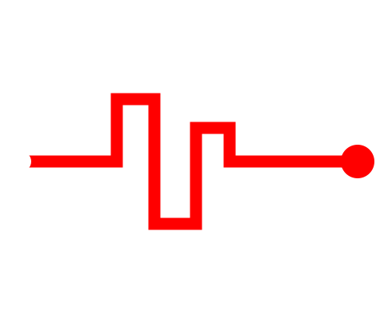

<p align="center"></p>

<h1 align="center">Observatorio BitRate</h1>
<p align="center"><b>Ransomware e infraestructura maliciosa en Argentina, a la vista.</b><br>Un proyecto de <b>Bitrate Infosec</b>.</p>

---

El Observatorio BitRate es un tracker público y automatizado que:

- 🟥 **Sigue las víctimas argentinas** que los grupos de ransomware reivindican en sus sitios de filtración (vía ransomware.live).
- 🛰️ **Detecta IOCs alojados en infraestructura argentina**, como servidores C2, URLs de malware y botnets (vía abuse.ch: ThreatFox, URLhaus y Feodo Tracker).
- 🔔 **Alerta por Discord** cuando aparece algo nuevo, con prioridad para lo que está en tu **watchlist**.
- 📊 **Publica un sitio web estático** con estadísticas, tendencias y tablas filtrables. Los IOCs se pueden exportar en CSV.
- 📝 **Genera un reporte semanal** en Markdown, listo para Discord y para publicar en Bitrate.

Costo: **$0**. Corre en GitHub Actions y se publica en GitHub Pages. No hay servidor ni base de datos expuesta.

## Arquitectura

```
GitHub Actions (cada 2 h)
  └─ python -m collector collect
       ├─ ransomware.live ──┐
       ├─ ThreatFox ────────┤→ filtro AR (.ar / DB-IP / ASN) → SQLite (data/observatorio.db)
       ├─ URLhaus ──────────┤                                        ├─→ Discord (webhook)
       └─ Feodo Tracker ────┘                                        └─→ site/data/*.json → GitHub Pages
```

```
observatorio-bitrate/
├── collector/              # Python: colector, filtros, alertas, reportes
│   ├── sources/            #   una fuente por módulo (fácil de ampliar)
│   ├── geo.py              #   ¿esto es de Argentina?
│   ├── discord.py          #   embeds con la estética Bitrate
│   ├── export.py           #   JSON para el sitio
│   ├── report.py           #   reporte semanal
│   └── main.py             #   CLI
├── site/                   # frontend estático (HTML + CSS + JS, sin dependencias)
├── data/observatorio.db    # histórico (lo commitea el bot)
├── reports/                # reportes semanales en Markdown
├── watchlist.txt           # dominios/organizaciones a vigilar
└── .github/workflows/      # automatización
```

## Puesta en marcha

### 1. Probar localmente (sin keys)

```bash
pip install -r requirements.txt
python -m collector demo                 # carga datos FICTICIOS
python -m http.server -d site 8000       # abrí http://localhost:8000
```

### 2. Conseguir las credenciales (todas gratis)

| Secret | Para qué | Dónde |
|---|---|---|
| `ABUSECH_AUTH_KEY` | ThreatFox + URLhaus (login con Google/GitHub) | https://auth.abuse.ch |
| `DISCORD_WEBHOOK_URL` | alertas | Discord → Canal → Editar → Integraciones → Webhooks |
| `DISCORD_WEBHOOK_REPORTS` | *(opcional)* canal aparte para reportes | ídem |
| `RANSOMWARELIVE_API_KEY` | *(opcional)* API PRO de ransomware.live | https://www.ransomware.live |

La geolocalización usa **DB-IP Lite** (gratis, sin registro): se descarga sola al correr `collect` (o con `python -m collector geo`) y en GitHub Actions queda en caché por mes. Si preferís MaxMind, poné `GeoLite2-Country.mmdb` y `GeoLite2-ASN.mmdb` en `data/` y se usan esas.

### 3. Correr con datos reales

```bash
cp .env.example .env    # completá tus keys
set -a; source .env; set +a
python -m collector collect
python -m collector report
python -m collector status   # estado de cada fuente
```

### 4. Publicarlo en GitHub

1. Creá el repo y subí el proyecto.
2. **Settings → Secrets and variables → Actions**: cargá los secrets de arriba.
3. **Settings → Pages → Source: GitHub Actions**.
4. **Actions → Observatorio BitRate → Run workflow** para la primera corrida.

Desde ahí se actualiza solo cada 2 horas, y los lunes manda el reporte semanal.

> En la primera corrida se cargan cientos de víctimas históricas. Para no inundar Discord, se manda un solo mensaje de "Observatorio en línea" y después se alertan solo las novedades.

### Dominio propio (opcional)
Creá `site/CNAME` con tu dominio (ej: `observatorio.bitrate.com.ar`) y apuntá un registro CNAME a `<usuario>.github.io`.

## Discord sugerido

```
📁 OBSERVATORIO
  #alertas-ransomware-ar    ← DISCORD_WEBHOOK_URL
  #reporte-semanal          ← DISCORD_WEBHOOK_REPORTS
  #charla
```

## Ética y legal: leelo antes de publicar

- **Solo metadatos.** El observatorio no accede a sitios .onion ni descarga, aloja o enlaza datos filtrados.
- **"Reivindicado", no "hackeado".** Los grupos de ransomware publican con fines extorsivos y a veces mienten. El sitio y las alertas lo aclaran siempre.
- **Correcciones y bajas:** `python -m collector hide <id>` oculta una víctima del sitio. Cambiá el mail de contacto en `site/index.html` (`#contact`).
- **Términos de las fuentes:** los datos de abuse.ch son de uso libre (CC0). **Revisá los Términos y Condiciones de ransomware.live** antes de publicar en abierto y mantené la atribución. Lo ideal es escribirles contando el proyecto. DB-IP Lite es CC BY 4.0: la atribución ya está en el sitio. Las bases `.mmdb` no se suben al repo (están en `.gitignore`).
- Los IOCs se muestran *desactivados* (`hxxp`, `[.]`) para evitar clics accidentales.

## Roadmap

- [ ] Detector de phishing contra marcas argentinas (certstream + typosquatting)
- [ ] Bot de Discord con comandos (`/victimas 7d`, `/grupo akira`)
- [ ] Fichas por grupo (TTPs MITRE ATT&CK, primeras/últimas apariciones)
- [ ] Exportación STIX 2.1 / feed MISP
- [ ] Feed RSS de víctimas y reportes

---
<sub>Hecho por Ezequiel “Toto” Retamar · Bitrate Infosec · Tecnicatura Universitaria en Ciberseguridad (UGR)</sub>
